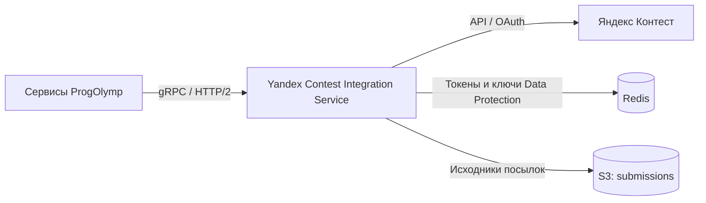

# Yandex Contest Integration Service

gRPC-сервис ProgOlymp для работы с API Яндекс Контеста. Предоставляет данные о соревнованиях, задачах, участниках и посылках, регистрирует участников, запускает перепроверку решений и сохраняет исходники посылок в S3-совместимое хранилище.

Приложение работает на ASP.NET Core / .NET 10. Исходящие запросы к Яндекс Контесту выполняются через `YandexContestClient` с общим OAuth-токеном сервисного аккаунта.

## Как устроен сервис



| gRPC-сервис | Возможности |
| --- | --- |
| `YandexAuthenticationService` | Получение URL авторизации, обмен кода на токен и проверка наличия токена. |
| `ContestDataService` | Ссылка на соревнование, его описание, задачи и таблица результатов с пагинацией. |
| `CompilerService` | Список доступных компиляторов. |
| `RegistrationService` | Регистрация и удаление участников, установка отображаемого имени при регистрации. |
| `ParticipantService` | Участие владельца токена, список участников, статус и статистика участника. |
| `SubmissionService` | Поток посылок, отчёт по тестам, сохранение исходника в S3 и перепроверка посылки. |

Контракты RPC находятся в [Protos/YandexContest](modules/Common.Contracts/Texnokaktus.ProgOlymp.Common.Contracts/Protos/YandexContest) подключённого submodule. Реализации — в [Services/Grpc](src/Texnokaktus.ProgOlymp.YandexContestIntegrationService/Services/Grpc).

`DownloadSubmissionSource` скачивает файл из Яндекс Контеста и загружает его в bucket `submissions`. Ответ содержит ключ объекта в поле `fileName`; содержимое файла и URL скачивания в ответ не входят. Ключ берётся из имени файла в `Content-Disposition`, а при его отсутствии — из идентификатора посылки.

## Структура репозитория

```text
.
├── Texnokaktus.ProgOlymp.YandexContestIntegrationService.slnx
├── Directory.Build.props            # Общие настройки сборки
├── Directory.Packages.props         # Версии NuGet-пакетов приложения (CPM)
├── AGENTS.md                        # Инструкции для работы с репозиторием
├── src/
│   └── Texnokaktus.ProgOlymp.YandexContestIntegrationService/
│       ├── Authentication/
│       ├── Extensions/
│       ├── Services/Grpc/
│       ├── Program.cs
│       ├── appsettings.json
│       └── Dockerfile
├── modules/
│   └── Common.Contracts/            # Git submodule со своим CPM
└── .github/workflows/dotnet.yml
```

Тестовых проектов сейчас нет. Общие настройки `TargetFramework`, `Nullable` и `ImplicitUsings` вынесены в корневой `Directory.Build.props`; особенности приложения и ссылки на зависимости остаются в `.csproj`.

## Подготовка и сборка

Понадобятся .NET SDK 10 и доступ к GitHub Packages организации `Texnokaktus-ProgOlymp`:

```text
https://nuget.pkg.github.com/Texnokaktus-ProgOlymp/index.json
```

Настройте источник и учётные данные в пользовательской конфигурации NuGet. В CI источник добавляется с использованием `GITHUB_TOKEN`.

Из корня существующего checkout выполните:

```powershell
git submodule update --init --recursive
dotnet restore Texnokaktus.ProgOlymp.YandexContestIntegrationService.slnx
dotnet build Texnokaktus.ProgOlymp.YandexContestIntegrationService.slnx --no-restore
```

URL submodule в `.gitmodules` использует SSH, поэтому для его загрузки нужен настроенный доступ к GitHub по SSH. Версии зависимостей приложения управляются корневым `Directory.Packages.props`; версии контрактного проекта — отдельным файлом внутри submodule.

## Конфигурация и зависимости

Настройки приложения находятся в `appsettings.json` и `appsettings.Development.json`. Для переопределения используйте переменные окружения; вложенные ключи разделяются двойным подчёркиванием.

| Переменная | Назначение |
| --- | --- |
| `SERVICE_NAME` | Имя сервиса для логов и телеметрии. Обязательно для `Texnokaktus.ProgOlymp.Platform`; профиль `http` и Docker-образ задают `YandexContestIntegrationService`. При запуске без профиля задайте переменную явно. |
| `ConnectionStrings__DefaultRedis` | Подключение к Redis. В базовой конфигурации — `host.docker.internal`, в Development — `raspberrypi.local`; для локального Redis переопределите на `localhost:6379`. |
| `YandexAppParameters__ClientId` | Client ID OAuth-приложения Яндекса. |
| `YandexAppParameters__ClientSecret` | Client Secret OAuth-приложения Яндекса. |
| `AWS__ServiceURL` | Адрес S3-совместимого хранилища. Значение `https://s3.example.com` в конфигурации — заглушка. |
| `AWS__ForcePathStyle` | Использование path-style адресации S3; в конфигурации включено (`true`). |
| `AWS_ACCESS_KEY_ID` | Ключ доступа к хранилищу. |
| `AWS_SECRET_ACCESS_KEY` | Секретный ключ доступа к хранилищу. |
| `ASPNETCORE_ENVIRONMENT` | Окружение приложения. Профиль запуска `http` устанавливает `Development`. |

### Redis и Data Protection

Сервис подключается к Redis при старте. Redis используется для распределённого хранилища OAuth-токенов и сохранения ключей ASP.NET Core Data Protection; токены защищаются через Data Protection.

В [Program.cs](src/Texnokaktus.ProgOlymp.YandexContestIntegrationService/Program.cs) вызван `DisableAutomaticKeyGeneration()`. Для записи и чтения защищённых токенов должен быть доступен заранее подготовленный набор ключей с подходящим discriminator приложения — `Texnokaktus.ProgOlymp.YandexContestIntegrationService`. Подготовка ключей в этом репозитории не реализована: одного пустого Redis недостаточно для полного цикла OAuth-авторизации.

### S3

Для сохранения исходников подготовьте bucket `submissions` и доступ на запись объектов в него. Имя bucket задано в `SubmissionServiceImpl`, отдельного параметра конфигурации для него сейчас нет. S3 используется методом `DownloadSubmissionSource`.

## Локальный запуск

После сборки подготовьте Redis с ключами Data Protection, OAuth-приложение Яндекса и, для выгрузки исходников, S3-хранилище. Задайте настройки в окружении текущего процесса, например в PowerShell:

```powershell
$env:SERVICE_NAME = "YandexContestIntegrationService"
$env:ConnectionStrings__DefaultRedis = "localhost:6379"
$env:YandexAppParameters__ClientId = "<client-id>"
$env:YandexAppParameters__ClientSecret = "<client-secret>"
$env:AWS__ServiceURL = "http://localhost:9000"
$env:AWS_ACCESS_KEY_ID = "<access-key>"
$env:AWS_SECRET_ACCESS_KEY = "<secret-key>"

dotnet run --project src/Texnokaktus.ProgOlymp.YandexContestIntegrationService --launch-profile http
```

Примеры значений в угловых скобках замените своими. Секреты передаются через окружение или внешнюю конфигурацию.

| Окружение | gRPC, HTTP/2 без TLS | HTTP/1 listener |
| --- | --- | --- |
| Development | `http://localhost:7234` | `http://localhost:5172` |
| Базовая конфигурация / контейнер | `http://0.0.0.0:8081` | `http://0.0.0.0:8080` |

Для RPC используйте gRPC-клиент с поддержкой HTTP/2 без TLS. При необходимости адреса можно переопределить через `Kestrel__Endpoints__Grpc__Url` и `Kestrel__Endpoints__Http__Url`.

### Авторизация в Яндексе

Сервис использует один общий OAuth-токен под ключом `DEFAULT`:

1. Вызовите `YandexAuthenticationService.GetOAuthUrl`, при необходимости передав `redirectUrl`.
2. Откройте полученный URL, авторизуйтесь нужным аккаунтом Яндекса и получите код авторизации.
3. Передайте код в `YandexAuthenticationService.AuthenticateService` в поле `code`.
4. Вызовите `YandexAuthenticationService.IsServiceAuthenticated` для проверки наличия токена.

После этого сервис использует сохранённый токен для запросов к `api.contest.yandex.net`. Доступность операций зависит от прав аккаунта в Яндекс Контесте. Проверка `IsServiceAuthenticated` определяет наличие токена, а не доступ к конкретному соревнованию.

### Диагностика

В Development включён gRPC reflection. При установленном `grpcurl` можно посмотреть список сервисов и проверить наличие токена:

```shell
grpcurl -plaintext localhost:7234 list
grpcurl -plaintext -d '{}' localhost:7234 YandexAuthenticationService/IsServiceAuthenticated
```

В остальных окружениях reflection не публикуется; для вызовов используйте `.proto` из submodule или сгенерированный клиент.

Логирование Serilog и OpenTelemetry подключаются через `Texnokaktus.ProgOlymp.Platform` вызовом `UsePlatform()` в `Program.cs`. Пакет задаёт консольный вывод и обогащение логов; дополнительные настройки Serilog читаются из конфигурации. Имя сервиса берётся из `SERVICE_NAME`, для трассировки дополнительно подключён источник `Microsoft.Kiota.Http.HttpClientLibrary`.

Проверка OAuth зарегистрирована через `AddHealthChecks`, но HTTP endpoint для health checks и gRPC health service сейчас не опубликованы.

## Docker и CI

Dockerfile расположен в каталоге приложения, **контекст сборки — корень репозитория**. Сборка требует инициализированного submodule и аргумента `GHPAT` для доступа к GitHub Packages. Например, при уже заданной переменной окружения `GHPAT`:

```shell
docker build --platform linux/amd64 --file src/Texnokaktus.ProgOlymp.YandexContestIntegrationService/Dockerfile --build-arg GHPAT --build-arg VERSION=0.0.0-local --tag yandex-contest-integration-service:local .
```

Контейнер слушает gRPC на порту `8081` и HTTP/1 на `8080`. При запуске передайте переменные из раздела конфигурации и адрес Redis, доступный из сети контейнера. Значение `localhost` внутри контейнера указывает на сам контейнер.

Workflow [.github/workflows/dotnet.yml](.github/workflows/dotnet.yml) запускается при push в `master`: восстанавливает зависимости, собирает solution и выполняет `dotnet test`. После успешной сборки публикует Docker-образы для `linux/amd64` и `linux/arm64` в GHCR и создаёт Git tag. Версия имеет вид `1.<run_number>.<run_attempt>`.
